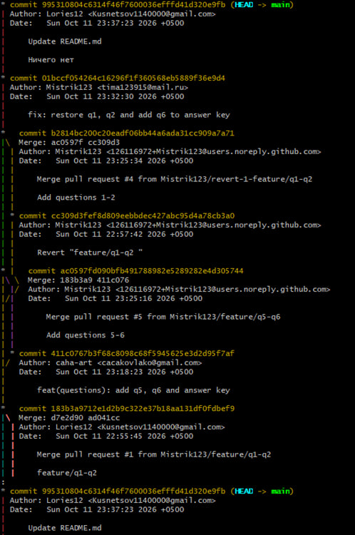
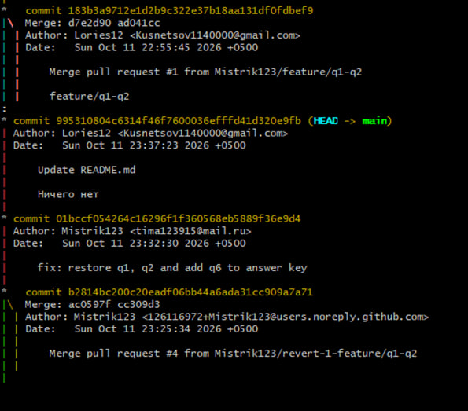
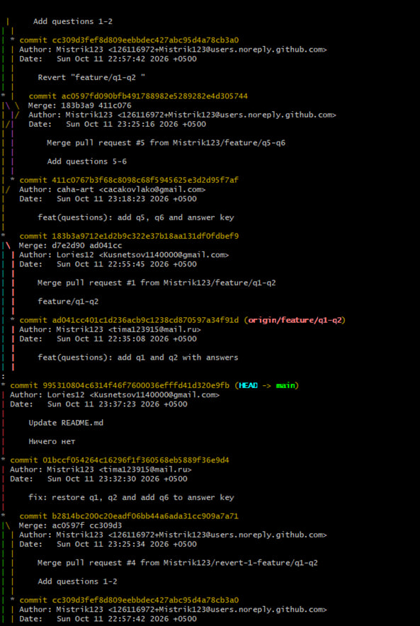
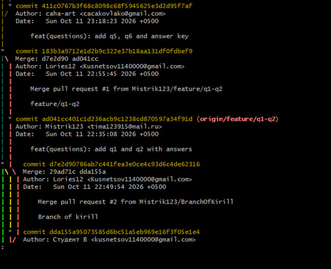
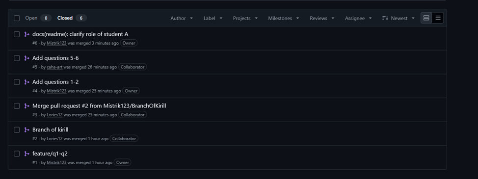
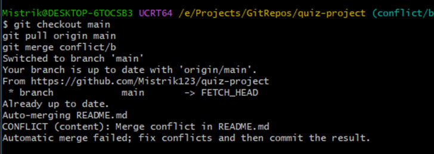
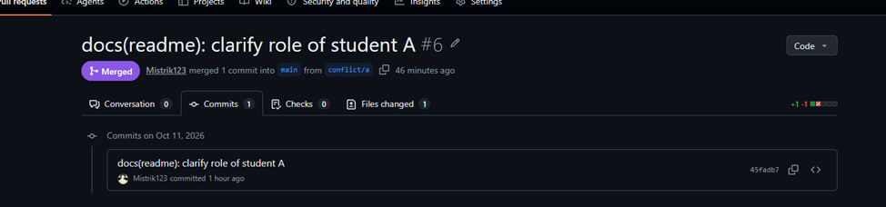

# Отчёт по практической работе
«Создание теста командой из трёх студентов в Git»

## 1. Тема и цель
Цель: освоить командную работу с Git через GitHub — ветки, Pull Requests, слияния, разрешение конфликтов.

## 2. Состав команды
| Роль | ФИО | GitHub |
|---|---|---|
| Team Lead | Гузий Тимофей Витальевич | @Mistrik123 |
| Разработчик | Кузнецов Кирилл Владимирович | @Lories12 |
| QA | Ковлаков Александр Владимирович | @caha-art |

## 3. Ссылка на репозиторий
https://github.com/Mistrik123/quiz-project

## 4. Распределение задач
- А: вопросы 1-2, README, PR-координация
- В: вопросы 3-4, участие в конфликте
- С: вопросы 5-6, answers.txt, финальная проверка, отчёт

## 5. Хронология работы
1. Создан репозиторий — 11.10.2026 20:30
2. Ветки feature/* — 11.10.2026 21:10
3. PR и merge — 11.10.2026 23:20
4. Конфликт и его разрешение — 12.10.2026 00:03
5. Финальная проверка — 12.10.2026 00:30

## 6. Использованные команды Git
| Команда | Назначение |
|---|---|
| git clone | клонирование репозитория |
| git checkout -b | создание ветки |
| git add / commit / push | фиксация и отправка изменений |
| git pull | получение изменений |
| git merge | слияние веток |
| git log --graph | просмотр истории |
| git status | проверка состояния рабочей директории |

## 7. Скриншоты

### 7.1. Граф коммитов

### 7.2. Список Pull Requests

### 7.3. Момент конфликта

### 7.4. Успешный merge

## 8. Возникшие трудности и их решение
В ходе выполнения практической работы команда столкнулась с рядом проблем, связанных с параллельной работой в Git:
- забывали удалять ветки после merge;
- создавали ветки от устаревшего main;
- при параллельной правке README.md возник конфликт слияния.

**Решение:**
- перед созданием ветки всегда выполняем git checkout main && git pull origin main;
- после merge удаляем ветку через git branch -d и кнопку Delete на GitHub;
- конфликт разрешён вручную: маркеры <<<<<<<, =======, >>>>>>> заменены на объединённый список состава команды, затем git add README.md и git commit.

## 9. Выводы
Практическая работа показала важность командной работы и согласованных действий при параллельной разработке. Мы освоили создание веток, Pull Requests, разрешение конфликтов слияния вручную, синхронизацию локальных и удалённых репозиториев.
